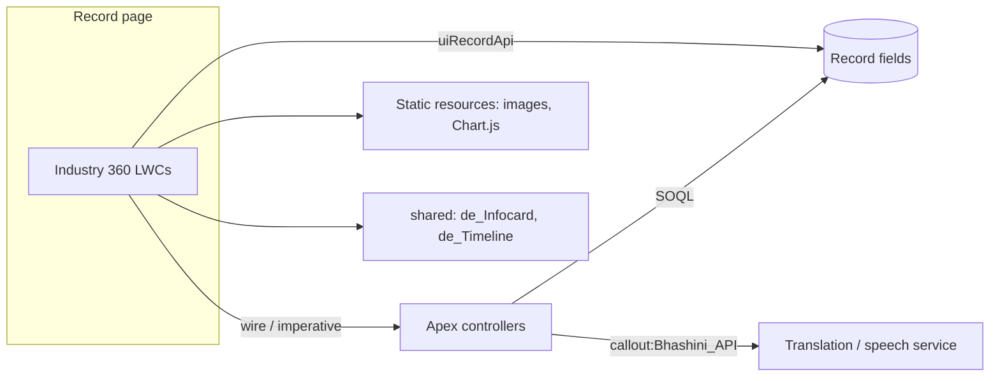

# Vista360

A gallery of Customer 360 Lightning Web Components, organised by industry: hospitality, jewellery, homeware, paints and loyalty, lifestyle retail, retail and logistics, and automotive. Every industry is a separate SFDX package directory, so you can deploy just the one you want.

All brands in this repo are fictional.

## What it does

Each industry module is a set of record-page LWCs that together build a single-screen "360" view of a customer (Contact, Person Account, Account or Loyalty Member): a profile header, stats bar, preferences, past activity, a timeline, and next-best-action or recommendation cards. The data shown comes from standard and custom fields on the record, from a few Apex controllers, and in some modules from demo placeholder data.

## Gallery by industry

| Industry (directory) | Fictional brand | Components | Highlights |
|---|---|---|---|
| `hospitality` | Lumen Stay | 11 LWCs (`de_GuestProfileCard`, `de_StatsBar`, `de_UpcomingBooking`, `de_PastReservations`, `de_BookingChart`, `de_Recommendations`, `de_SurpriseDelight`, `de_PastGlitches`, `de_ReservationNotes`, `de_Household`, `de_leadSummary_Stat`) | Guest profile, bookings chart (Chart.js), recommendations. Apex: `de_GuestProfile_Controller` |
| `jewellery` | (generic) | 7 LWCs `de_jw*` | Contact card, metal affinity, festival buying pattern, loyalty, previous purchases, next best action, recommendations |
| `homeware` | Hearthwell | 10 LWCs `de_hearth*` | Customer 360 shell, profile card, stats bar, engagement, insights, loyalty, orders, wishlist, recommendations, timeline. Includes 47 Account custom fields, a permission set and a Lightning page |
| `paints-loyalty` | Brightwall / Greenfield Paints | 14 LWCs | Loyalty member header, tabs, enrolled schemes, eligibility, transactions, top products, predictive scores, financial insights, property details. Apex: `DE_TransactionController` |
| `lifestyle-retail` | Urbanweave | 10 LWCs | Customer header and details, loyalty programme, marketing preferences, preferred brands/size, shopping preferences, location, AI insights, next best actions. Apex: `de_CustomerController` (+ test) |
| `retail-logistics` | Vista | 11 LWCs | Account details, active shipments, cases, contacts, service appointments, sales/service/logistics/analytics snapshots, loyalty card. 4 Apex controllers and 7 Contact custom fields |
| `automotive` | Velo Motors | 20 LWCs | Vehicle owned, booked vehicle, warranties, fleet attributes, service behaviour banner, customer journey, verbatim capture (voice and translation), social media, sales dashboard, custom activity timeline |
| `shared` | n/a | `de_Infocard`, `de_Timeline`, `de_Timeline_Controller` | Components reused across industries, plus the `chartjs` static resource. Listed first in `sfdx-project.json` |

## Architecture



All package directories share one namespace, so `c/` imports work across directories. That is why `shared` must be deployed together with any industry.

## Prerequisites

- Salesforce CLI (`sf`) and a Developer Edition or sandbox org
- Node 18+ only if you want to run lint or Jest (`npm install`)
- Person Accounts enabled for the modules that read Person Account fields (`retail-logistics`)

## Setup and deploy

Deploy everything:

```bash
sf project deploy start --source-dir force-app --target-org <alias>
```

Or one industry plus the shared module:

```bash
sf project deploy start --source-dir force-app/shared --source-dir force-app/homeware --target-org <alias>
```

Then add the components to Lightning record pages in App Builder. `homeware` ships a ready-made Lightning page (`de_Hearth_Customer_360`) and permission set (`DE_Hearth_360_Access`).

## Configuration

| Item | Where | What to do |
|---|---|---|
| Demo contact IDs | `automotive` LWC `de_demoScenarios` (`DEMO.C1` to `C10`) | Replace the `REPLACE_ME_CONTACT_ID_n` placeholders with Contact IDs from your org. Some automotive components key their demo behaviour off these |
| Translation / speech service | Named Credential `Bhashini_API` (used by `de_recent_launches_Apex`) | Create an External Credential and Named Credential with that name pointing at your speech/translation provider, and add the auth header there. No key is stored in this repo |
| Consumer site URL | Custom Label `Velo_Consumer_Site_Url` (automotive) | Replace the `REPLACE_ME` value |
| Prompt template | `Velo_Sales_Pitch_Feedback` (referenced by `de_recent_launches_Apex`) | Create a prompt template with this name, or edit the class to use your own |
| Custom fields | `homeware` (Account, `de_*`) and `retail-logistics` (Contact) | Deployed with the modules; populate them with your own data |
| Images | Static resources | All images are generated placeholders. Replace the files inside each resource with your own artwork, keeping the file names |

## Notes

- Components that depended on Apex classes missing from the source projects were left out so that the deploy succeeds.
- The automotive timeline uses `de_Auto_Timeline_Controller`, which returns Tasks related to the record page's record.
- Add screenshots under `docs/screenshots/`.

## License

MIT, see [LICENSE](LICENSE).
